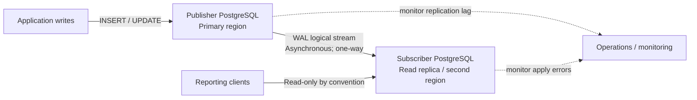

# Portfolio 5 — Distributed and Cloud Databases

## Objective

This exercise demonstrates a practical distributed-database pattern using PostgreSQL logical replication: one writable publisher and a separately hosted subscriber that can serve read traffic. The example uses synthetic Eco Hub University campus and energy-reading data, consistent with the earlier portfolios. It creates an isolated `p5_cloud` schema and does not alter the Portfolio 1 tables.

> **Scope and evidence:** The SQL and runbook are prepared for execution on two PostgreSQL instances. I have not connected to a cloud service or run these scripts in this environment, so no execution results or screenshots are claimed. Run the exercise in your own test environment and add genuine screenshots/results if your assessment requires them.

## Architecture



The publisher owns writes. PostgreSQL's logical replication sends row changes from the publication to a subscription on the subscriber. Replication is asynchronous, so the subscriber may briefly be behind. This example is **not** automatic multi-primary replication, sharding, or a managed-cloud deployment. Failover requires an operator to promote/redirect traffic and reconfigure replication; do not assume zero data loss.

## Files

- [`Obiekwe_Chinonso_Emmanuel_301925165_P5_Publisher.sql`](Obiekwe_Chinonso_Emmanuel_301925165_P5_Publisher.sql) — creates and seeds publisher tables, then creates the publication.
- [`Obiekwe_Chinonso_Emmanuel_301925165_P5_Subscriber.sql`](Obiekwe_Chinonso_Emmanuel_301925165_P5_Subscriber.sql) — creates matching subscriber tables and prompts for the publisher connection before creating a subscription.
- [`Obiekwe_Chinonso_Emmanuel_301925165_P5_Verification.sql`](Obiekwe_Chinonso_Emmanuel_301925165_P5_Verification.sql) — checks replicated row counts, sample readings, and subscription status/lag.

## Requirements and safe setup

- Two PostgreSQL 15+ instances, or two local test instances, with network connectivity from subscriber to publisher. Use the same database name on both.
- On the **publisher**, `wal_level = logical`, and sufficient `max_wal_senders` and `max_replication_slots`; restart PostgreSQL after changing settings.
- The publisher's firewall and `pg_hba.conf` must permit the subscriber host. Prefer TLS and a dedicated least-privilege login. Do not expose a database port to the public internet.
- The replication login needs `LOGIN`, `REPLICATION`, `USAGE` on schema `p5_cloud`, and `SELECT` on both published tables. Create/manage credentials securely (for example, `.pgpass`); never commit passwords or production connection strings.
- Run all scripts against a **disposable test database**, not a production database. Publisher setup drops and recreates only its `p5_cloud` tables/publication. Subscriber setup expects fresh tables and a subscription name not already in use.

Example publisher-side grants (replace the role name to suit your test environment; configure authentication separately):

```sql
CREATE ROLE p5_repl LOGIN REPLICATION;
GRANT USAGE ON SCHEMA p5_cloud TO p5_repl;
GRANT SELECT ON p5_cloud.campus_site, p5_cloud.energy_reading TO p5_repl;
```

## Run the exercise

1. On the publisher, create/select the test database, apply the publisher script as an administrator, then create the replication login and grants above. Configure the publisher's PostgreSQL settings and network access before continuing.
2. On the subscriber, create/select a separate database with the same database name. Run the subscriber script as an administrator. At the prompt, enter a libpq connection string such as `host=publisher.example port=5432 dbname=portfolio_test user=p5_repl sslmode=verify-full`. Configure certificate verification and password handling for your environment; do not paste secrets into a shared terminal or repository.
3. Wait briefly for the initial table copy and streaming to start. Run the verification script on the subscriber. Repeat verification after inserting a new test row on the publisher to observe replication. The initial expected sample totals are **2 campus sites** and **4 readings**.
4. Capture your own output if evidence is required. Suggested screenshots: publisher publication and sample counts; subscriber subscription status and matching counts; and a newly inserted publisher row appearing on the subscriber. Ensure connection strings, usernames, hostnames, and credentials are not visible.

The scripts are intentionally split by server: run the publisher script only on the publisher, the subscriber script and verification only on the subscriber. The subscriber SQL is a one-time setup. To repeat from a clean test run, remove the subscription on the subscriber first (`DROP SUBSCRIPTION p5_energy_sub;`), then rerun the publisher setup and subscriber setup. Dropping/recreating the publisher publication while a subscriber is active disrupts that subscription.

## Evaluation and operational considerations

- **Consistency / availability:** Asynchronous replication improves read availability and can reduce read load on the primary, but replicas are eventually consistent. A just-committed write may not yet be visible on the subscriber.
- **Write ownership:** Keep writes on the publisher. This avoids conflicting writes and sequence/key collisions that multi-primary designs must solve.
- **Monitoring:** Check `pg_stat_subscription` and replication-worker errors on the subscriber; monitor publisher WAL retention/replication slots and disk capacity. A stalled subscriber can cause WAL to accumulate on the publisher.
- **Security:** Restrict network access, use TLS and a dedicated replication account, rotate credentials, and grant only the needed privileges.
- **Limitations:** Logical replication does not automatically replicate DDL, roles, or large objects. Schema changes must be coordinated on both nodes. This simple two-node demonstration does not implement automated failover, conflict resolution, cross-region latency testing, backups, or disaster-recovery guarantees.

## References

- [PostgreSQL — Logical Replication](https://www.postgresql.org/docs/17/logical-replication.html)
- [PostgreSQL — Logical Replication Publication](https://www.postgresql.org/docs/17/logical-replication-publication.html)
- [PostgreSQL — Logical Replication Subscription](https://www.postgresql.org/docs/17/logical-replication-subscription.html)
- [PostgreSQL — Monitoring](https://www.postgresql.org/docs/17/monitoring-stats.html)
